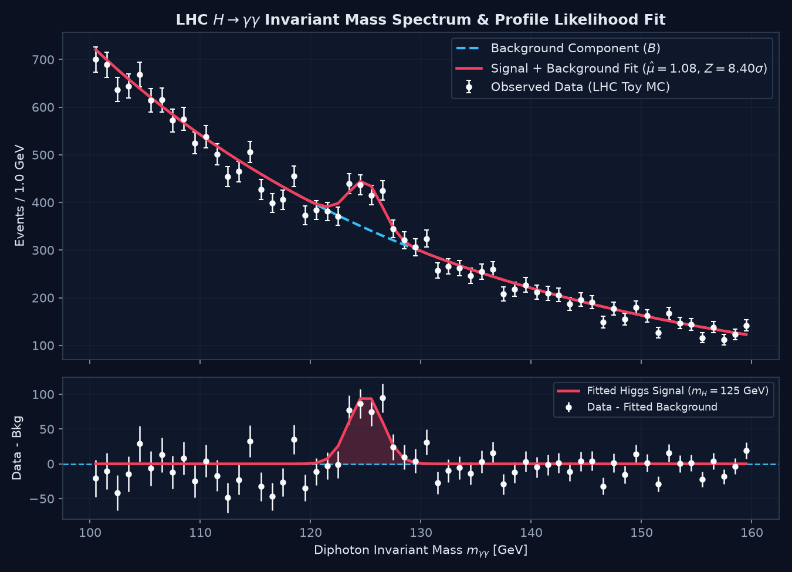
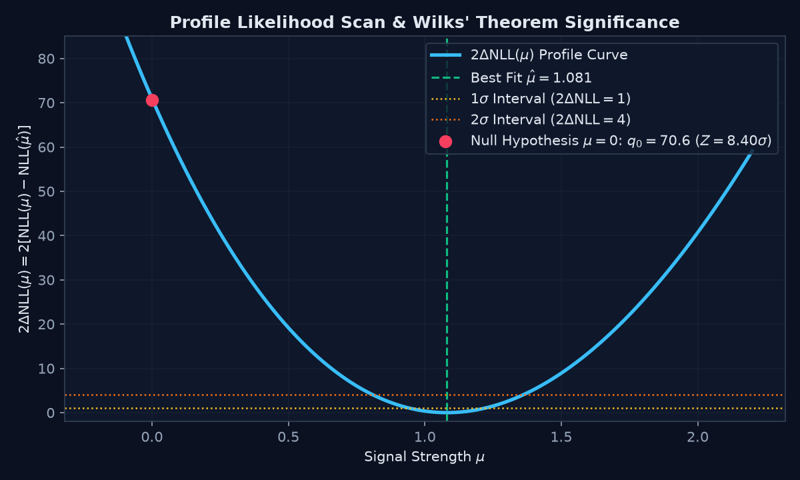
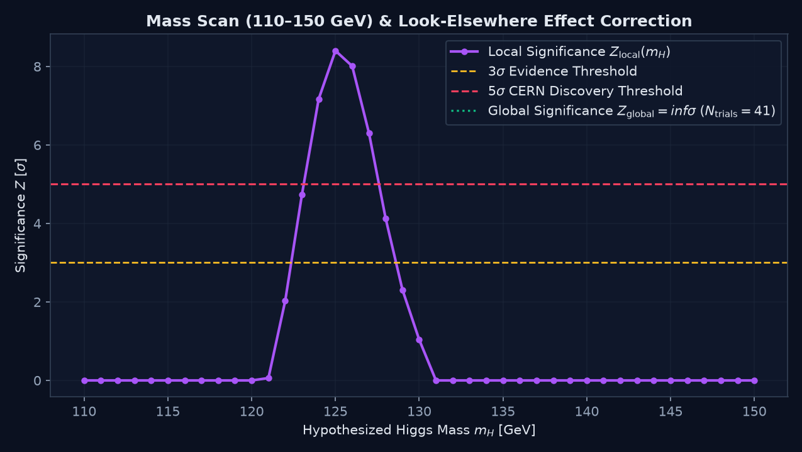

# Bump Hunter — LHC $H \to \gamma\gamma$ Statistical Discovery Engine

A pure-Python (`NumPy` / `SciPy` / `Matplotlib`) implementation of the frequentist statistical discovery and exclusion pipeline used in High Energy Physics (ATLAS & CMS at the CERN Large Hadron Collider) to detect a resonant particle decay ("bump") on top of a falling continuum background.

---

## Overview & Physical Motivation

In collider experiments, short-lived particles such as the Standard Model Higgs boson ($m_H \approx 125\text{ GeV}$) decay almost instantaneously. In the diphoton decay channel ($H \to \gamma\gamma$), the invariant mass $m_{\gamma\gamma}$ of photon pairs is reconstructed across a search window $[100, 160]\text{ GeV}$:

1. **Continuum Background ($B$):** Non-resonant quantum electrodynamics/QCD diphoton production follows a smoothly falling exponential spectrum $p_b(m) \propto e^{-\lambda m}$.
2. **Resonant Signal ($S$):** Higgs boson decays produce a narrow resonance at $m_H = 125\text{ GeV}$, smeared by the electromagnetic calorimeter resolution ($\sigma \approx 1.5\text{ GeV}$) into a Gaussian peak.



---

## Mathematical & Statistical Formulation

### 1. Binned Poisson Likelihood (`src/bumphunter/likelihood.py`)
Given $K$ histogram bins $[a_i, b_i]$, the expected event yield $\nu_i$ in bin $i$ is parameterized by the signal strength modifier $\mu$ ($\mu=0$: background-only; $\mu=1$: Standard Model Higgs) and nuisance parameters $\theta = (B_{\text{tot}}, \lambda)$:

$$\nu_i(\mu, B_{\text{tot}}, \lambda) = \mu \cdot S_{\text{nom}} \cdot p_{s,i}(m_H, \sigma) + B_{\text{tot}} \cdot p_{b,i}(\lambda)$$

Each bin count $n_i \sim \text{Poisson}(\nu_i)$ contributes to the binned Poisson Negative Log-Likelihood (NLL, up to additive constants):

$$\text{NLL}(\mu, B_{\text{tot}}, \lambda) = \sum_{i=1}^{K} \left[ \nu_i - n_i \ln(\nu_i) \right]$$

### 2. Profile Likelihood Ratio & $5\sigma$ Discovery (`src/bumphunter/discovery.py`)
To test for a positive signal excess against the background-only null hypothesis ($H_0: \mu = 0$), we compute the one-sided profile log-likelihood ratio test statistic $q_0$:

$$q_0 = \begin{cases} 2 \left( \text{NLL}_0 - \text{NLL}_1 \right) & \text{if } \hat{\mu} > 0 \\ 0 & \text{if } \hat{\mu} \le 0 \end{cases}$$

where $\text{NLL}_0 = \min_{B_{\text{tot}}, \lambda} \text{NLL}(0, B_{\text{tot}}, \lambda)$ and $\text{NLL}_1 = \min_{\mu, B_{\text{tot}}, \lambda} \text{NLL}(\mu, B_{\text{tot}}, \lambda)$. By Wilks' asymptotic theorem, the local discovery significance in Gaussian standard deviations is:

$$Z_{\text{local}} = \sqrt{q_0}, \qquad p_{\text{local}} = 1 - \Phi(Z_{\text{local}})$$

A localized excess reaching $Z \ge 5\sigma$ ($p_{\text{local}} \le 2.87 \times 10^{-7}$) constitutes an official particle discovery.



### 3. Look-Elsewhere Effect & $95\%$ CL Upper Limits (`src/bumphunter/limits.py`)
When scanning across $N_{\text{trials}}$ hypothesized mass points $m_H \in [110, 150]\text{ GeV}$, the probability of observing a random background fluctuation anywhere in the search window increases according to the trials penalty:

$$p_{\text{global}} = 1 - (1 - p_{\text{local}})^{N_{\text{trials}}}, \qquad Z_{\text{global}} = \max\!\left(0,\; \Phi^{-1}(1 - p_{\text{global}})\right)$$

In mass regions where no significant excess is observed, a one-sided $95\%$ Confidence Level (CL) upper limit is placed on the signal strength:

$$\mu_{95} = \max(0, \hat{\mu}) + 1.64485 \cdot \sigma_{\mu}$$

where $\sigma_{\mu} = \left(\frac{\partial^2 \text{NLL}}{\partial \mu^2}\Big|_{\hat{\mu}}\right)^{-1/2}$ is extracted from the local curvature (Hessian) of the NLL.



---

## Repository Structure

```text
bump-hunter/
├── notebooks/
│   ├── bump_hunter_analysis.ipynb     # End-to-end Jupyter Notebook with derivations & plots
│   ├── 01_mass_spectrum_fit.png       # Diphoton spectrum + background-subtracted residuals
│   ├── 02_profile_likelihood_scan.png # 2*Delta NLL(mu) parabolic profile scan
│   └── 03_mass_scan_lee.png           # Mass scan (110-150 GeV) & Look-Elsewhere correction
├── src/
│   └── bumphunter/
│       ├── __init__.py                # Package exports
│       ├── data.py                    # Inverse-transform MC background & Gaussian signal generator
│       ├── likelihood.py              # Analytical bin expectations & Poisson NLL
│       ├── discovery.py               # Profile likelihood fits (H0 vs H1), q0, Z, and p-value
│       ├── limits.py                  # Mass grid scan (LEE) & 95% CL upper limits (mu_95)
│       └── laboratory_article.html    # Interactive HTML5 Virtual Collider Laboratory
├── requirements.txt
└── README.md
```

---

## Quickstart

### 1. Install Dependencies
```bash
python3 -m venv venv
source venv/bin/activate
pip install -r requirements.txt
```

### 2. Run Individual Statistical Modules
Each module includes a standalone experiment benchmark block:
```bash
python3 src/bumphunter/data.py
python3 src/bumphunter/likelihood.py
python3 src/bumphunter/discovery.py
python3 src/bumphunter/limits.py
```

### 3. Interactive HTML5 Virtual Collider Laboratory
Open `src/bumphunter/laboratory_article.html` in any modern browser to interactively adjust the collider luminosity, injected Higgs signal strength $\mu$, mass $m_H$, detector resolution $\sigma$, and trial factor $N_{\text{trials}}$ with real-time HTML5 Canvas visualizations.
# bump-hunter
